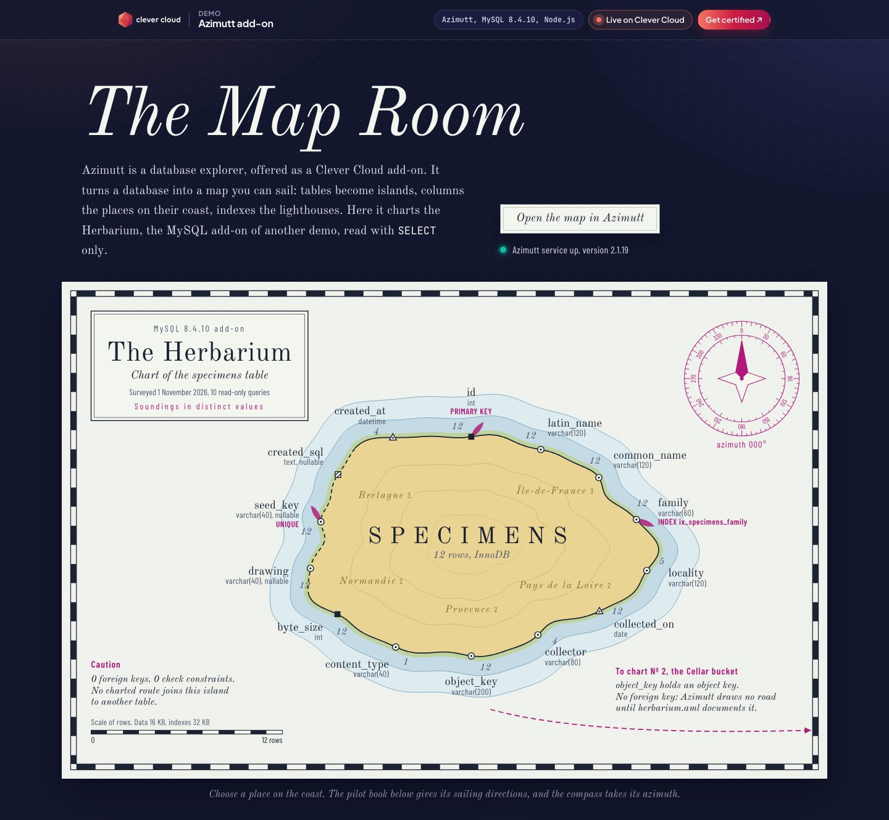
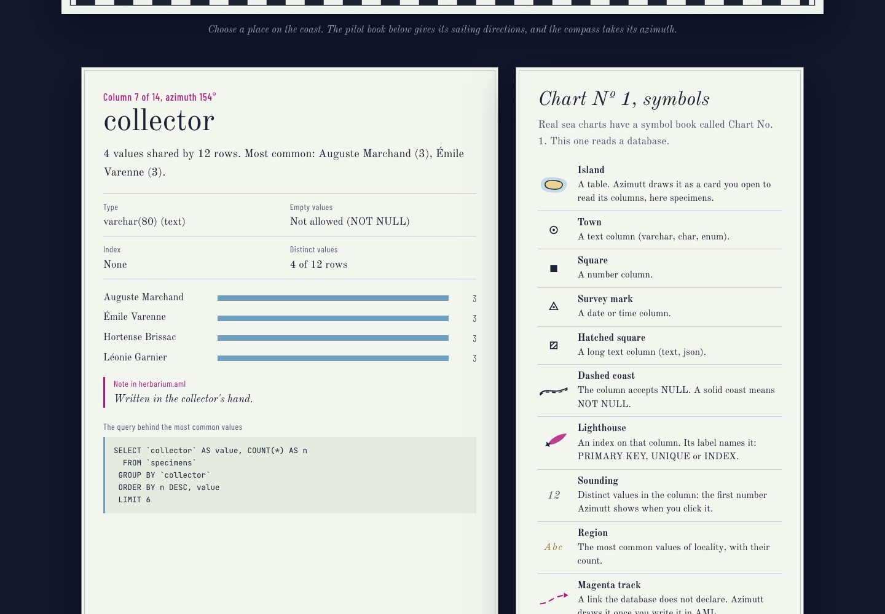
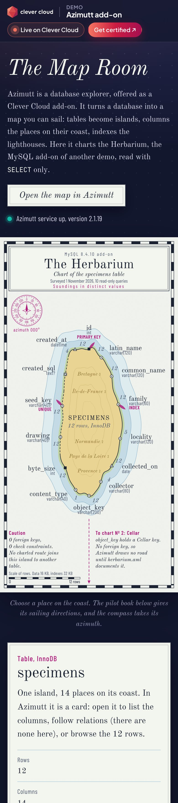

# The Map Room — the Azimutt add-on on Clever Cloud

> Azimutt, the database explorer add-on, turns a database into a map you can sail. This demo charts the Herbarium, the MySQL add-on of a sibling demo, as a nautical chart: the table is an island, each column a place on its coast, indexes are lighthouses, soundings are distinct values, and the road to the Cellar bucket leaves the chart because no foreign key can describe it. Tap a place and the pilot book gives its sailing directions, with the exact SQL that measured it; the ship's log lists every query Azimutt's MySQL connector sends. The companion app is Node.js with the standard library only, dressed in the **Clever Brand Kit**.



| Pilot book and Chart Nº 1 | Phone |
|---|---|
|  |  |

**Run it yourself.** The hosted demo was taken down after the presales review (November 2026), and so was the Herbarium's MySQL it explored. The steps in [Deploy on Clever Cloud](#deploy-on-clever-cloud) recreate the map room and the Azimutt add-on from scratch in about 10 minutes, sign-in included. For a database to explore, [deploy demo-python-mysql-cellar](https://github.com/Vitiosum/demo-python-mysql-cellar#deploy-on-clever-cloud) first (about 10 more minutes), or point Azimutt at any MySQL or PostgreSQL database.

**Get certified.** This demo runs on Clever Cloud. To deploy your own apps the same way, get certified at the [Clever Cloud Academy](https://academy.clever.cloud/).

---

## What each piece does

| Piece | Role in the demo |
|---|---|
| **Azimutt add-on** (`azimutt`, plan `free`) | The database explorer itself. You open it from the Clever Cloud Console, signed in with your Clever Cloud account, paste a database URI, and explore the schema and the rows. The add-on injects no variable into the app. |
| **MySQL add-on** of the Herbarium ([`demo-python-mysql-cellar`](https://github.com/Vitiosum/demo-python-mysql-cellar)) | The territory. Azimutt reads it through its gateway; this repo only ever read it with `SELECT` (survey below). Not linked to this app. Recreate it from that repo, or explore any other MySQL or PostgreSQL database instead. |
| **Companion app** (this repo, Node.js runtime) | The map room: draws the survey as a chart, explains what Azimutt shows, links to it, and checks that the Azimutt service answers (`/health/deep`). |
| `azimutt/` | Ready-made material for the Azimutt project: `herbarium.aml` (the whole map in AML, every column documented, plus the Cellar road), `notes.md`, `layouts.md`. |
| `survey/herbarium.json` | The chart data: a read-only survey of the Herbarium's `information_schema` and column statistics, made by `scripts/survey.js`. |

---

## Deploy on Clever Cloud

**First, a database to explore.** The Herbarium's MySQL was deleted with the hosted demo. Either [deploy demo-python-mysql-cellar](https://github.com/Vitiosum/demo-python-mysql-cellar#deploy-on-clever-cloud) first (its MySQL add-on is the territory charted here), or point Azimutt at any MySQL or PostgreSQL database you can reach: Azimutt itself works with either. The chart on this page stays the committed survey of the Herbarium until you [resurvey](#resurvey-the-database) a MySQL database.

You need [clever-tools](https://www.clever.cloud/developers/doc/cli/) (`clever login` done) and the ID of the organisation that will own the resources (`orga_…`, shown in the Console). Run the commands from the repo root: `clever create` links the folder to the new app.

```bash
# 1. The companion app and its size
clever create --type node demo-azimutt --org <org_id> --region par
clever scale --min-flavor nano --max-flavor XS --min-instances 1 --max-instances 2
clever scale --build-flavor M

# 2. Azimutt (plan free; no option offered, so no encryption option)
clever addon create azimutt demo-azimutt-map --plan free --org <org_id> --region par
clever service link-addon demo-azimutt-map          # optional: the add-on injects no variable

# 3. Variables
clever env set NODE_ENV production
clever env set CC_HEALTH_CHECK_PATH /health

# 4. Deploy
clever deploy
clever open
```

`NODE_ENV=production` makes `npm install` skip the dev dependencies (the MySQL client and the AML parser, used by the survey and the tests only): the app has no runtime dependency at all. Node.js 24 comes from `engines.node`. There is no secret to generate and no setup script on the Clever side; `GET /health/deep` checks that the Azimutt service answers. Then sign in to Azimutt, below.

---

## Open the map in Azimutt (two minutes, in a browser)

Azimutt is a marketplace add-on: it signs you in through the Clever Cloud Console (SSO), so this step is yours, not a script's.

1. In the [Clever Cloud Console](https://console.clever-cloud.com/), open the organisation, then the add-on **demo-azimutt-map**, and follow its link to Azimutt. The first time, Azimutt creates your account from your Clever Cloud identity.
2. Azimutt opens on its Clever Cloud welcome page, with a *Database URI* field.
3. In the Console, open the Herbarium's MySQL add-on (**herbarium-mysql** if you followed the [Herbarium README](https://github.com/Vitiosum/demo-python-mysql-cellar#deploy-on-clever-cloud)) and copy its connection URI. Any other MySQL or PostgreSQL URI works too. Paste it nowhere but Azimutt.
4. In Azimutt, paste it into *Database URI* and choose *Connect database*. Keep the default storage (encrypted in your browser): the URI is sent to the gateway only, never stored by Azimutt's servers.
5. The `specimens` table appears. Click it, click a column for its statistics (they match the soundings on the chart for the 12 seed specimens), and open the rows. With another database, its own tables appear instead.
6. Optional, for the full story: add `azimutt/herbarium.aml` as an AML source (the *Copy AML* button on the page puts it on your clipboard). It draws `cellar.objects` and the `object_key -- key` road. Then build the two layouts from `azimutt/layouts.md` and paste the notes from `azimutt/notes.md`.

Free plan: schema and data exploration, 2 layouts, 10 notes, up to 10 tables written in AML. The project cannot be saved: reconnect at each session (the URI stays in your browser).

---

## Resurvey the database

The chart is a dated survey, like a real one. To redraw it after the Herbarium changes:

```bash
npm install                                          # dev dependencies: mysql2, @azimutt/aml
npm run resurvey -- <mysql_addon_id>                 # addon_… (clever addon list); writes survey/herbarium.json
git commit -am "Resurvey" && clever deploy
```

`scripts/resurvey.js` reads the add-on's variables with clever-tools and keeps them in memory, fetches the MySQL add-on's auto-generated CA certificate, then runs `scripts/survey.js`. The survey runs inside a `READ ONLY` transaction, refuses any statement that is not a single `SELECT`, queries `information_schema` with `TABLE_SCHEMA = DATABASE()` (so no schema name lands in the output), and never prints a credential. The TLS certificate is always checked: MySQL's auto-generated certificates name no host, so the server must present a certificate signed by that CA (MySQL's `VERIFY_CA` mode).

Any MySQL works with `MYSQL_ADDON_URI=… npm run survey` (add `SURVEY_TLS_CA=<ca.pem>` for a self-signed server). A local stand-in is in `test/fixtures/herbarium-local.sql`.

---

## Variables

| Variable | Where | Use |
|---|---|---|
| `NODE_ENV` | app | `production`: no dev dependencies on the instance |
| `CC_HEALTH_CHECK_PATH` | app | `/health`, checked by Clever Cloud at each deployment |
| `PORT` | platform | 8080 |
| `CC_APP_NAME`, `APP_ID`, `INSTANCE_NUMBER`, `INSTANCE_TYPE`, `CC_PRETTY_INSTANCE_NAME`, `CC_COMMIT_ID`, `CC_DEPLOYMENT_ID` | platform | shown in the "Running on Clever Cloud" panel, nothing else is ever printed |
| `MYSQL_ADDON_URI`, `SURVEY_TLS_CA`, `SURVEY_OUT` | your laptop only | the survey (set by `npm run resurvey`) |

---

## Routes

`GET /` (the map room), `GET /health` (200, touches nothing), `GET /health/deep` (checks the Azimutt service at `azimutt.app/health`: 200 when it answers with its database up, 503 otherwise; cached 30 s), `GET /survey.json`, `GET /azimutt/herbarium.aml`, `/azimutt/notes.md`, `/azimutt/layouts.md`, and the static assets. Other verbs → 405, other paths → 404. Strict CSP on every response (no inline script or style).

---

## Local development

```bash
npm install
PORT=8640 npm start          # http://localhost:8640
npm test                     # 21 tests: survey guard and builder, chart, AML parsed by Azimutt's own parser, routes
```

Requires Node.js 24 or later.

---

## Project structure

```
server.js              → HTTP server, routes, security headers, content-hashed asset URLs
src/chart.js           → the nautical chart (inline SVG): island, places, lighthouses, soundings, compass rose
src/view.js            → pilot book entries and ship's log from the survey, notes read from herbarium.aml
src/page.js            → the page, inside the Clever frame (top bar, platform panel, footer with the Academy badge)
src/azimutt.js         → the Azimutt service check used by /health/deep
src/platform.js        → the 7 platform variables the panel may show
scripts/survey.js      → read-only survey of a MySQL database → survey/herbarium.json
scripts/resurvey.js    → the same, for a Clever Cloud MySQL add-on, credentials kept in memory
azimutt/               → herbarium.aml, notes.md, layouts.md, for the Azimutt project
public/                → maproom.css, maproom.js, and the Clever Brand Kit (cc-brand.css copied as-is)
test/                  → node:test suites and the local MySQL fixture
```

[Source code on GitHub](https://github.com/Vitiosum/demo-azimutt) · MIT licence.
